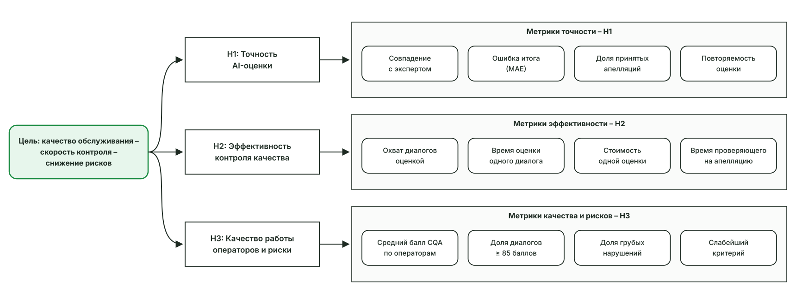
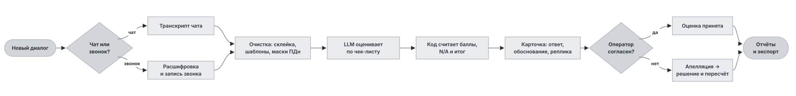
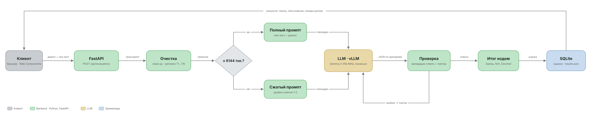
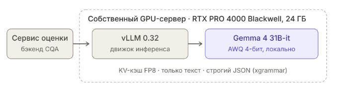

Решение от команды: master_cheeks(Madi and Amre) 
Прилагаем документацию


Задача стояла в том чтобы разработать прототип интеллектуальной CQA-системы для автоматической оценки качества клиентских диалогов по настраиваемому чек-листу.

1. Система должна анализировать разговоры с помощью ИИ, выставлять оценки с объяснениями и подтверждающими фрагментами диалогов, рассчитывать итоговый балл и учитывать N/A.

2. Также необходимо реализовать механизм апелляций, позволяющий оспаривать оценки, проводить повторную проверку и сохранять окончательные решения

1.2  Древо метрик:


1.3  Как продукт используется в бизнес процессе


Пайплайн проекта 



About our LLM solution



---

# CQA — оценка качества диалогов

Оценивает работу оператора в чатах и звонках по настраиваемому чек-листу: ответ, баллы, обоснование и реплика-доказательство по каждому критерию. Есть апелляции, пересчёт итога, AI-помощник для чек-листа и автооценка по расписанию. Модель подключается через любой OpenAI-совместимый API, например свой vLLM: данные не уходят в облако.

## Запуск

Нужен Python 3.11+.

```bash
pip install fastapi uvicorn      # для тестов ещё: pip install pytest
```

Создайте в корне файл `.env`. Адрес и токен модели указываете сами, в git они не попадают:

```env
CQA_LLM_URL=http://<host>:<port>/v1   # OpenAI-совместимый API
CQA_LLM_KEY=<токен>
```

```bash
python -m uvicorn app.main:app
```

Откройте http://127.0.0.1:8000. При первом запуске создаётся `cqa.db` с базовым чек-листом.

Необязательные переменные:

| Переменная | По умолчанию | Зачем |
|---|---|---|
| `CQA_LLM_MODEL` | первая из `/models` | имя модели |
| `CQA_LLM_CTX` | `6144` | контекст модели в токенах (промпт + ответ) |
| `CQA_LLM_TIMEOUT` | `300` | тайм-аут запроса к модели, с |
| `CQA_DATASET_URL` | — | GET-ссылка на набор диалогов без `group_id` (пакетная и автооценка) |
| `CQA_DB` | `cqa.db` | путь к базе SQLite |

## Как пользоваться

- **Конструктор чек-листа** — критерии, веса, шкалы, N/A. Сохранение создаёт новую версию, прежние оценки остаются привязаны к своей. Кнопка «AI-помощник» в углу собирает чек-лист по текстовому запросу.
- **Новая оценка** — загрузите JSON или текст вида `оператор: текст`, выберите чек-лист, нажмите «Запустить оценку». Над формой включается автооценка по расписанию.
- **Диалоги → Анализ** — оценка рядом с транскриптом. Клик по доказательству ведёт к реплике, клик по реплике звонка — к этому месту в записи.
- **Оценки** — список с экспортом каждой оценки в Excel или JSON.
- **Апелляции** — «Оспорить оценку» в карточке, затем решение проверяющего и пересчёт итога.

## Командная строка

```bash
python -m app.batch --dataset dev --group-id <ID> --fetch       # загрузить набор и оценить
python -m app.batch --dataset dev --only-missing --workers 1   # доценить недостающее по одному
python -m app.export_results --dataset dev --group-id <ID>      # results/dev/results.json
python -m app.validate_results results/dev/results.json --dataset dev --group-id <ID>
python -m pytest tests
```

После каждой оценки `results/<набор>/results.json` обновляется сам.

## Структура

```
app/        сервер: оценка, очистка транскриптов, чек-листы, апелляции, экспорт, расписание
web/        интерфейс на чистом JS (веб-компоненты, без сборки)
tests/      pytest
datasets/   сохранённые наборы диалогов
results/    выгрузка результатов
```
